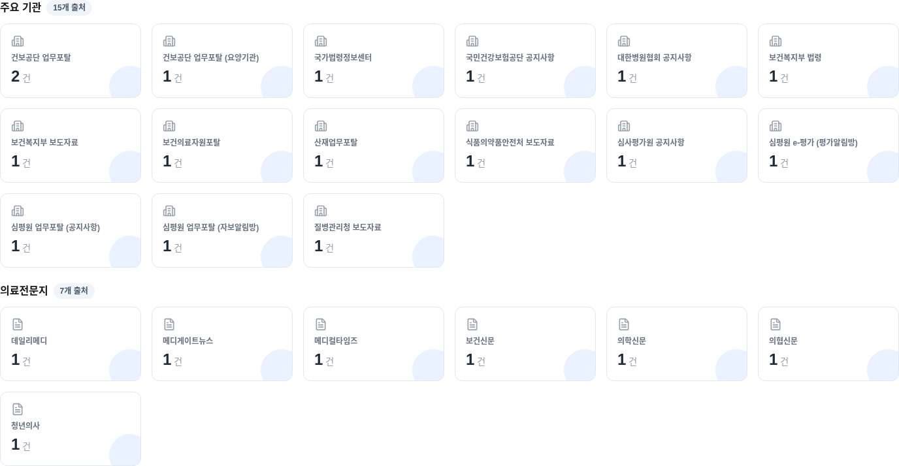
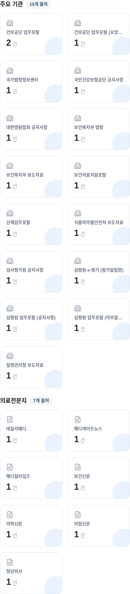

# MB-005 검증 보고서

## A. Executive Summary

출처별 건수 카드를 주요 기관 15개 / 의료전문지 7개로 구분했습니다. 카드 디자인·그룹 내 기존 정렬·클릭·건수 집계와 상단 필터를 유지합니다. 미분류 신규 출처는 기타 출처로 표시합니다. 운영 배포 및 자동 병합은 수행하지 않습니다.

## B. Baseline

- 기준 main/작업 시작 HEAD: `f0f17655c9cd356f861e6a94e41d7faeed60cb7a` (GitHub API 확인 후 Git fetch로 재확인).
- 시작 브랜치: `work`; working tree: clean.
- 작업 브랜치: `feat/mb-005-source-card-groups`.
- 열린 PR: #54 Collector 파싱/복구, #55 LAW 인증값 처리, #38 운영 릴리즈 문서. 카드 구현과 겹치는 작업 없음. 해당 PR은 수정하지 않음.
- 카드/필터/집계/CSV 다운로드/인쇄: `src/components/ArticleList.tsx`.
- 집계: 기존 `sourceCounts`가 `initialArticles`를 source 문자열로 집계.
- 데이터/검색: `src/lib/articlesServer.ts`, `src/app/api/articles/route.ts`와 기존 ArticleList fetch.
- 다운로드는 기존의 UTF-8 BOM CSV이며, XLSX 전환은 하지 않음.

## C. Changed Files

- `src/components/ArticleList.tsx`: 카드 영역에 그룹 제목·자동 출처 수·섹션 추가.
- `src/lib/sourceCardGroups.ts`: 카드 전용 출처 유형 레지스트리와 그룹화 함수.
- `tests/sourceCardGroups.test.mjs`: 4개 단위 테스트.
- `tests/sourceCardGroups.browser.py`: 실제 컴포넌트와 main 버전 비교 브라우저 회귀 검사.
- `docs/mb-005/README.md`, `cards-1440.png`, `cards-390.png`, `print-verification.pdf`: 검증 문서/이미지/인쇄 샘플.

## D. Implementation Details

- 명시적인 `institution` / `medical_press` 유형을 프런트엔드 카드 전용으로 관리합니다. DB schema 변경 없음.
- 기존 고정 출처는 19개이고 보도자료 3개는 응답에서 동적으로 추가되던 구조입니다. 상단 필터의 목록 생성은 그대로 두고, 카드 영역만 22개 레지스트리와 현재 출처 목록의 합집합을 표시합니다. 응답이 비어도 22개 카드는 0건으로 유지됩니다.
- 기존 `Set` + 기본 `sort()` 순서를 그룹 안에서 유지합니다. 고객 목록의 나열 순서로 재정렬하지 않습니다.
- 카드 렌더링·선택 handler·`sourceCounts`를 변경하지 않습니다. 각 그룹의 sources.length로 배지 수를 계산합니다.
- 등록되지 않은 출처는 정렬된 기타 출처에 한 번 표시합니다. 기타 출처가 없으면 섹션을 숨깁니다. 객체 prototype 이름과 같은 입력도 안전하게 처리합니다.
- 카드 그리드는 기존과 같이 모바일 2열 / md 4열 / lg 6열이며 인쇄에서는 그룹 전체를 숨깁니다.

## E. Source Mapping

프런트엔드 `Article`에는 별도 source ID가 없으며 `Article.source` 문자열이 필터·집계·선택의 실제 식별자입니다. Collector가 만드는 문자열과 sourceLinks 규칙을 읽기 전용으로 확인했습니다. 아래 이름을 그대로 키로 사용하며 별칭으로 출처를 추가하지 않습니다. 고객 표기의 괄호 앞 공백 차이는 기존 저장/표시명을 보존했습니다. `메디컬타임즈`는 기존 카드 이름이며, 기존 디자인 분기 속 `메디칼타임즈` 문자열을 별도 출처로 만들지 않습니다.

| 실제 source 식별자 / 표시명 | 유형 |
| --- | --- |
| 건보공단 업무포탈 | institution |
| 건보공단 업무포탈 (요양기관) | institution |
| 국가법령정보센터 | institution |
| 국민건강보험공단 공지사항 | institution |
| 대한병원협회 공지사항 | institution |
| 보건복지부 법령 | institution |
| 보건복지부 보도자료 | institution |
| 보건의료자원포탈 | institution |
| 산재업무포탈 | institution |
| 식품의약품안전처 보도자료 | institution |
| 심사평가원 공지사항 | institution |
| 심평원 e-평가 (평가알림방) | institution |
| 심평원 업무포탈 (공지사항) | institution |
| 심평원 업무포탈 (자보알림방) | institution |
| 질병관리청 보도자료 | institution |
| 데일리메디 | medical_press |
| 메디게이트뉴스 | medical_press |
| 메디컬타임즈 | medical_press |
| 보건신문 | medical_press |
| 의학신문 | medical_press |
| 의협신문 | medical_press |
| 청년의사 | medical_press |

기존 의료전문지 최신기사 API 그룹은 6개 출처를 사용하는 별도 기능입니다. 이번 작업의 7개 카드 분류와 혼합하지 않았으며 API·수집 범위를 변경하지 않았습니다.

## F. Test Results

- `npm test`: 191/191 통과 (기존 187 + 신규 4).
- `npm run lint`: 전체 통과.
- `npm run build`: 통과 (로컬 빌드, 배포 아님).
- `npx tsc --noEmit`: 통과.
- `python tests/sourceCardGroups.browser.py`: 통과.
- `git diff --check`: 통과.
- 단위 검사: 22/15/7, 중복·누락 없음, 빈 응답 시 22개 유지, 신규 미분류 출처, 기존 순서·식별자 유지.
- 브라우저 검사: 실제 컴포넌트/합성 기사 23건/모의 GET API 사용. main의 변경 전 컴포넌트와 22개 카드 건수·그룹 내 순서·필터 버튼 목록·CSV 바이트 일치 확인. 카드 22개 클릭, 선택 필터, 검색 응답 반영, 인쇄 호출 및 print media 숨김 확인. 브라우저 pageerror 없음.
- 브라우저 스크립트는 임시 fixture route와 baseline 컴포넌트를 생성한 후 종료 시 삭제합니다. 생성된 dev route 타입도 정리합니다. 별도 dev server가 실행 중이지 않은 작업 사본에서 실행하세요. Python Playwright와 `/usr/bin/chromium`이 필요합니다.

## G. Regression Results

- `node --test tests/test_admin_security.mjs tests/test_admin_routes_integration.mjs`: 16/16 통과. 기존 로컬 모의 서비스 사용.
- `CUSTOMER_AUTH_TEST_ORIGIN=http://127.0.0.1:3106 node --test tests/test_customer_auth_http.mjs`: 4/4 통과. 별도 로컬 production build server 사용, Foundation 미설정 상태의 fail-closed/접근 제어 확인.
- 검색·출처 필터·목록·카드 클릭·건수·CSV·인쇄 로직 유지. 기존 인증/내부 Admin 코드 수정 없음.
- 최초 테스트 시 설치 누락 및 sandbox subprocess EPERM이 있었으나 의존성 설치/실행 권한 조정 후 통과. HTTP 검사 최초 실행은 loopback origin 미지정으로 시작 전 거절되었고 명시적 로컬 서버로 재실행하여 통과.
- 최초 빌드는 임시 fixture 삭제 후 남은 generated dev 타입 때문에 실패했으며, 테스트 종료 시 generated 타입 정리 후 전체 lint/build/typecheck 통과.
- Collector 및 Actions 변경 없음. DB·인증 정책·운영 환경변수 수정 없음.

## H. Mobile Verification

Chromium viewport 1440 / 768 / 390 / 375px에서 22개 카드 유지, 카드 영역 내부 가로 overflow 없음, 카드 폭이 viewport 이내임을 확인했습니다. 아래 이미지는 운영 데이터가 아닌 합성 기사 검증 화면입니다. 긴 출처명의 말줄임은 기존 카드 디자인을 유지합니다.

[인쇄 검증 PDF](print-verification.pdf)

## I. Risks / 배포 시 주의사항

- 운영 데이터/실제 고객 로그인/실기기 Safari는 검증하지 않았습니다. 브라우저 검사는 합성 응답, 인증 검사는 로컬 환경입니다.
- 카드는 기존과 같이 initialArticles 누적 건수를 사용합니다. 검색/시간 변경 후 재집계 방식으로 바꾸지 않았습니다.
- 새 이름은 별칭으로 추정 병합하지 않습니다. 알려진 source 문자열의 추가/변경은 레지스트리에 명시하고 기존 필터·집계 계약도 함께 검토해야 합니다.
- 새 미분류 출처가 응답에 포함되면 기타 출처로 보존됩니다. 응답에 없는 미등록 출처를 DB에서 별도로 조회하지는 않습니다.
- 운영 배포 없음. 추후 승인된 배포에는 DB migration·환경변수·Collector 변경이 필요하지 않습니다.

## J. PR URL

현재 작업의 GitHub PR 및 최종 보고에서 제공합니다.

## K. Merge Recommendation

로컬 검증 기준 병합 가능. PR CI 완료와 사용자 검토/승인 후 수동 병합을 권장합니다. 자동 병합 미설정, 운영 배포 미실행.

## L. Codex Usage Report

사용량/잔여량을 조회할 도구가 제공되지 않아 추정하지 않습니다.

| 항목 | 결과 |
| --- | --- |
| 컨텍스트 사용량 | 조회 불가 |
| 토큰 사용량 | 조회 불가 |
| 남은 컨텍스트 비율 | 조회 불가 |
| 주간 사용량 | 조회 불가 |
| 주간 잔여량 | 조회 불가 |
| 주간 제한 초기화 시각 | 조회 불가 |
| 5시간 한도 사용량 및 잔여량 | 조회 불가 |
| 초기화권 남은 횟수 | 조회 불가 |
| 초기화권 날짜 | 조회 불가 |
